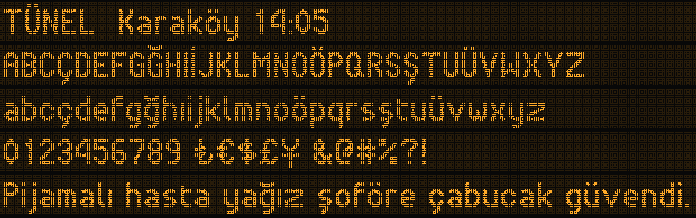

# Tünel

A dot-matrix typeface for LED signs, named after Tünel, the Istanbul underground line that has
run between Karaköy and Beyoğlu since 1875. It is drawn with a 2-dot stroke and built to read
from a distance: metro platforms, departure boards, scrolling banners.



## Download

Get the latest zip from [Releases](../../releases), or take the files from `fonts/`:

| Folder | What | Use it for |
| --- | --- | --- |
| `fonts/variable/` | `Tunel[ROND,wght].ttf` | Apps and design tools that support variable fonts |
| `fonts/ttf/` | 9 static weights, Thin to Black | Desktop use, older apps |
| `fonts/otf/` | The same 9 weights with CFF outlines | Print and design tools that prefer OpenType CFF |
| `fonts/web/` | Every font as WOFF2, plus `tunel.css` | Websites |

On a Mac, double-click a font file and press Install. On Windows, right-click and choose
Install. On the web:

```html
<link rel="stylesheet" href="fonts/web/tunel.css">
<style> body { font-family: "Tünel", monospace; font-weight: 400; } </style>
```

## Axes

Two axes change only the dot, never the grid, so every setting keeps the same letterforms:

- `wght` 100 to 900: dot size, from thin dots to touching dots. Named instances Thin,
  ExtraLight, Light, Regular, Medium, SemiBold, Bold, ExtraBold, Black.
- `ROND` 0 to 100: dot shape, from square to round. The static fonts use round dots.

## Character set

361 characters:

- Uppercase: `A` to `Z` with every accented form of Latin-1 and Latin Extended-A
  (`Ç Ğ İ Ö Ş Ü`, `À Á Â Ã Ä Å`, `Č Ď Ě Ň Ř Š Ť Ů Ž`, `Ą Ę Ł Ń Ś Ź Ż`, `Æ Œ Ø Þ Ð ẞ` and more)
- Lowercase: `a` to `z` with the same accents, plus `ı ß æ œ ø þ ð ŋ ſ`
- Figures: `0` to `9`, all one width so numbers line up on a board, with `¹ ² ³ ¼ ½ ¾`
- Punctuation and symbols: `. , : ; … ! ? ¡ ¿ ' " ‘ ’ “ ” ‹ › « » -`, the en and em dash,
  `( ) [ ] { } / \ | ¦ @ # & % * + = < > ± × ÷ ¬ ~ ^ _ § ¶ © ® ™ ° µ • ·`
- Currency: `₺ € $ £ ¥ ¢ ¤`
- Arrows: `← ↑ → ↓`

That covers Turkish and every language written in Basic Latin, Latin-1 and Latin Extended-A:
English, German, French, Spanish, Portuguese, Italian, Dutch, the Nordic languages, Polish,
Czech, Slovak, Hungarian, Romanian, Croatian, Slovenian, the Baltic languages, Maltese and
others.

> Pijamalı hasta yağız şoföre çabucak güvendi.

## How it is drawn

Every glyph starts as a skeleton on a 1-dot grid, and two rules draw it:

1. Every dot becomes a 2 by 2 block, so every stroke is exactly 2 dots wide.
2. Where two dots touch only at a corner, the two dots between the blocks are lit, so a curve
   or a diagonal keeps its 2-dot weight.

So every lit dot lies inside a lit 2 by 2 square, and no dot ever sticks out.

The letters are proportional and share their parts: B D P R share one bowl, R takes the leg of
K, n h m u share one arch, b d p q share the bowl of o, W is M upside down, 9 is 6 turned.
Accented letters are built from a base letter and a mark, so fixing a letter fixes every
accented form of it. The grid is 22 rows: capitals 14, x-height 10, descenders 4.

## Build

```
python3 -m venv .venv && .venv/bin/pip install "fonttools[woff]" pillow
.venv/bin/python build.py specimen.png "Line one" "Line two"   # glyphs.json and a preview
.venv/bin/python test.py                                       # checks every glyph
.venv/bin/python font.py                                       # every font in fonts/
```

- `skeletons.txt`: the 1-dot skeletons
- `glyphs.txt`: glyphs and marks drawn directly on the 2-dot grid
- `test.py`: checks for stray dots, lumps, symmetry, shared parts, line heights and coverage

## License

SIL Open Font License 1.1, see [`OFL.txt`](OFL.txt). Free to use, modify and share, in
personal and commercial work.
